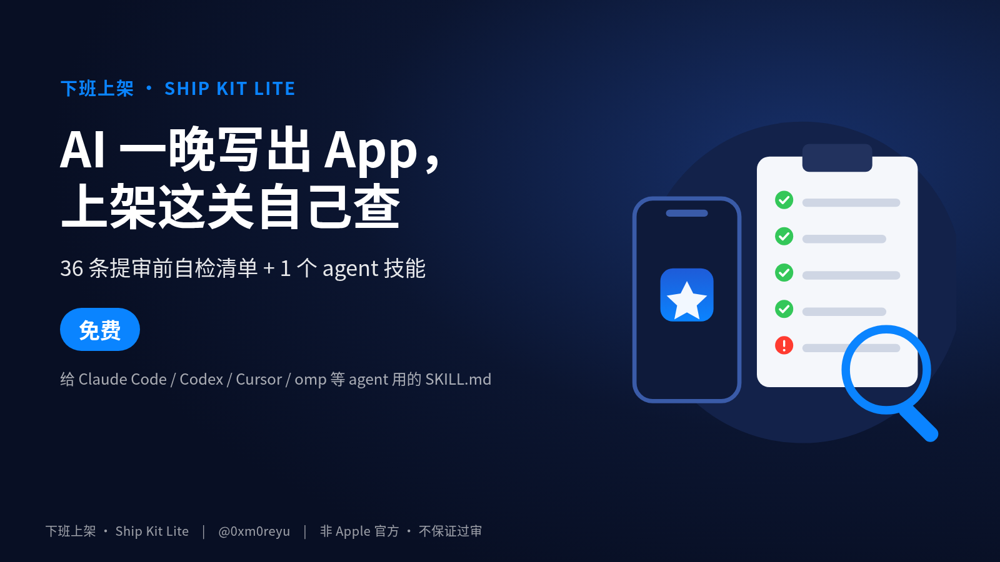

# 下班上架 · Ship Kit Lite

Free open-source App Store pre-submission checklist + 1 agent skill for indie iOS/macOS builders.



给 **AI 编程 agent**（Claude Code / Codex / Cursor / omp 等）用的 App Store 提审前自检工具包 · **免费 Lite 版**。面向已经能用 AI 写出 SwiftUI 原型、但卡在提审这一步的中文独立开发者。纯文本 Markdown，无二进制、无运行时代码。

---

## 包含什么

| 文件 | 作用 |
| --- | --- |
| `CHECKLIST.md` | 36 条核心自检项，分 7 段（工程与构建、隐私与数据合规、内购与订阅、元数据、截图与预览、审核备注与最低功能、中国区） |
| `skills/app-store-review-precheck/SKILL.md` | 唯一技能：让 agent 按 Guideline 逐条自检，输出 Checklist / Specific Fixes / Next Step |
| `skills/app-store-review-precheck/references/guidelines-cheatsheet.md` | Guideline 速查 + ASC 字段硬限制（名称 2–30、副标题 ≤30、关键词 ≤100 字节等） |

```
ship-kit-lite/
├── README.md
├── CHECKLIST.md
├── LICENSE
├── .gitignore
├── assets/cover.png
└── skills/app-store-review-precheck/
    ├── SKILL.md
    └── references/guidelines-cheatsheet.md
```

---

## 三步用法

1. **下载本仓库**（或 Release 里的 `ship-kit-lite.zip`）。
2. **装技能或 @ 引用**：
   - Claude Code：把整个文件夹复制到 `~/.claude/skills/app-store-review-precheck/`（`references/` 要一起带上），然后**新开一次会话**。
   - Codex / Cursor / omp 等：对话里 `@skills/app-store-review-precheck/SKILL.md`（按需再 @ `guidelines-cheatsheet.md`）。
3. **让 agent 自检**：例如「提审前帮我逐条自检」，要求输出打勾清单 + 按条款编号的修复建议 + 下一步。也可只用 `CHECKLIST.md` 手动打勾。

---

## 免责声明

- **不保证过审**。审核结果由 Apple App Review 独立决定。
- **与 Apple、工信部及任何监管机构无关联**，非官方产品。
- 不代办备案；是否需要备案以接入商 / 分发平台及主管部门最新口径为准。
- 一切以 Apple / 工信部官方最新文档为准；本包仅为操作手册与检查清单。
- 本仓库及落地页**无联盟 / 返利链接**。

完整版（5 个技能 + 模板 + 6 个月更新）还在做，可先登记候补：[候补登记页](https://moreyu.github.io/ship-kit-lite/waitlist/)（GitHub Pages，`docs/waitlist`）。

---

## License

MIT License. Copyright (c) 2026 More yu.
